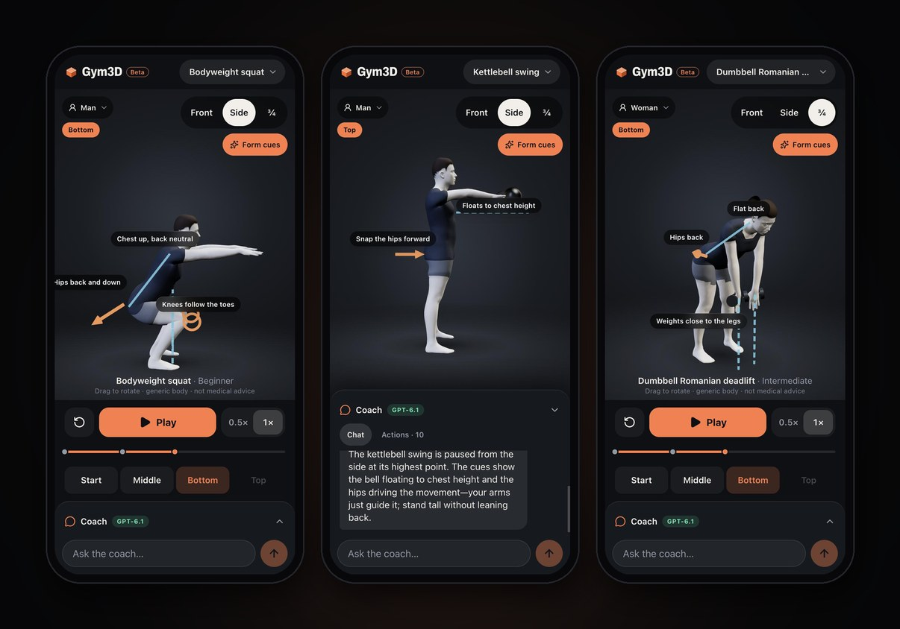
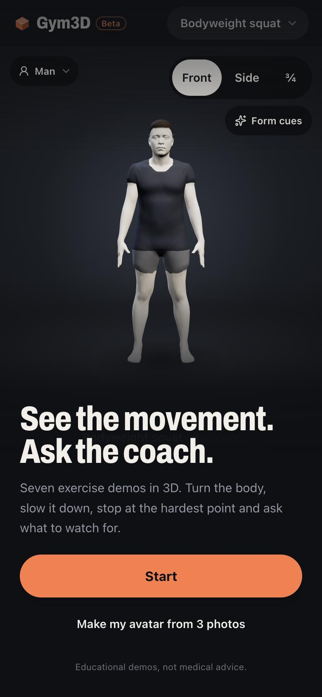
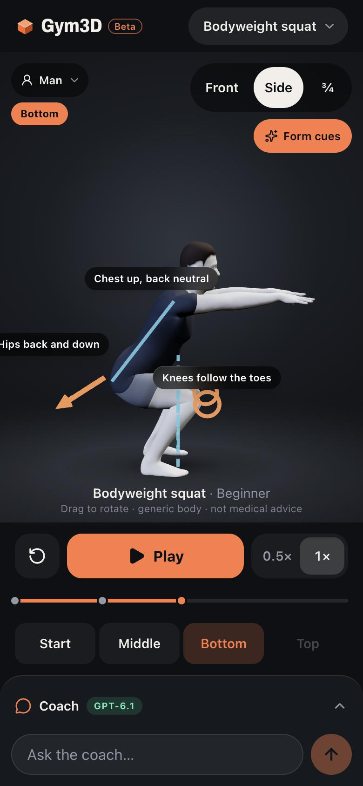
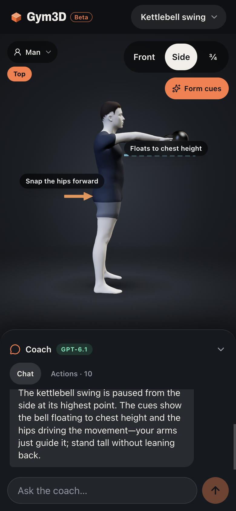
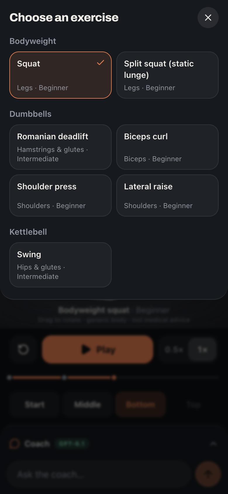
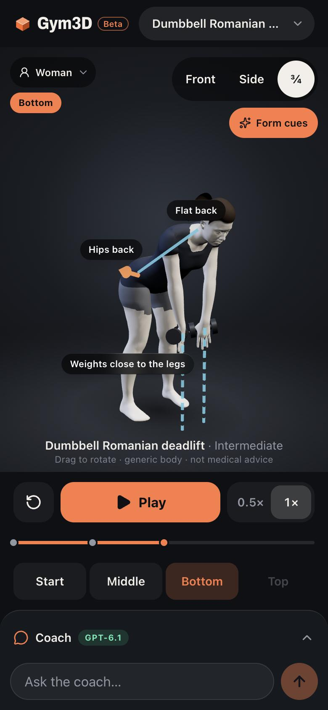
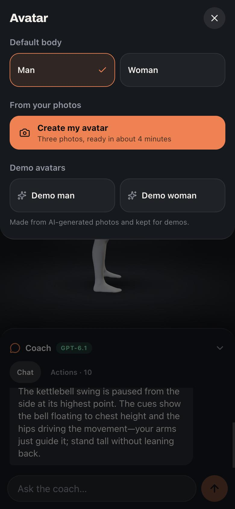

# Gym3DBeta

**3D exercise demos you can steer by talking to an AI coach.**

> **An experiment, not a product.** Gym3DBeta is a personal side project built to test OpenAI's latest model, **GPT-6.1 Sol**, on a concrete job. The model doesn't only chat: it drives a live 3D scene through strict tool calls (pick an exercise, turn the camera, slow down, stop at the hardest point, show form cues) and explains what you're looking at. The interesting question was how much of an app a model can steer reliably once it is given a small, validated set of actions. Everything here is a work in progress: expect rough edges, and don't take it as fitness or medical advice.

<p align="center">
  
</p>

<p align="center">
  <a href="https://forma-ai-coach-nine.vercel.app"><b>Live demo</b></a> ·
  built for iPhone Safari (works on desktop too) ·
  
  
  
  
</p>

---

## What it does

- **Seven animated exercises** on a realistic human body: bodyweight squat, split squat, dumbbell Romanian deadlift, biceps curl, shoulder press, lateral raise and kettlebell swing.
- **Full playback control:** drag to rotate; front, side and ¾ views; play, pause, replay; 0.5× and 1× speed; jump to the start, middle, bottom or top of a rep.
- **Form cues drawn in 3D:** arrows, lines and labels attached to the body ("hips back", "weights close to the legs") that follow the movement.
- **A coach you can talk to.** Ask "show me a kettlebell swing from the side and stop where the bell is highest" and GPT-6.1 Sol picks the exercise, moves the camera, seeks the phase, turns on the right cues and answers in one or two sentences. Every action it takes appears in an **Actions** log.
- **Man and woman bodies,** plus two demo avatars rebuilt from AI-generated photos.
- **An avatar from your own photos (experimental):** three photos (front, side, back) become a textured, rigged 3D body that performs all seven exercises, in about four minutes. Personal avatars are deleted after 24 hours.
- **Installs on the iPhone home screen** as a full-screen web app.

## Screenshots

<table>
  <tr>
    <td align="center"><br><sub>Welcome</sub></td>
    <td align="center"><br><sub>Form cues at the bottom of a squat</sub></td>
    <td align="center"><br><sub>The coach drives the scene</sub></td>
  </tr>
  <tr>
    <td align="center"><br><sub>Exercise picker</sub></td>
    <td align="center"><br><sub>Romanian deadlift, ¾ view</sub></td>
    <td align="center"><br><sub>Bodies and avatars</sub></td>
  </tr>
</table>

## How the coach works

The model interprets what you want; the app decides what is allowed and does it. GPT-6.1 Sol never touches the animation directly.

```text
 You ─▶ "Slow it down and pause at the bottom"
         │
         ▼
 POST /api/coach  (Next.js route, server only)
   ├─ system prompt + exercise catalog + current scene state
   ├─ OpenAI Responses API, one strict tool: control_scene(commands[])
   └─ Zod validation: unknown exercises, phases or cues are rejected
         │
         ▼
 { message: "Here's the bottom, at half speed…",
   commands: [ set_speed 0.5, seek_phase bottom, pause, show_cues [...] ] }
         │
         ▼
 Browser: validates again in the scene reducer, then plays it in three.js
```

The command set is deliberately small: `select_exercise`, `play`, `pause`, `set_speed`, `set_view`, `seek_phase`, `reset`, `show_cues` and `clear_cues`. Coaching text comes from a hand-written catalog of cues for each exercise, so the model explains the cues the app can draw instead of inventing thresholds. When you ask for an exercise that isn't in the catalog, the coach says so and offers a supported one.

What the experiment showed so far:

- **Reliable enough to feel natural.** In the 8-prompt test suite (`npm run coach:eval`), every live response produced valid commands, with a median round trip of about 3.4 s on the deployed site.
- **One round trip** whenever all commands validate. The model only gets a second turn when it needs to see a tool error.
- **The app keeps working without it.** With no API key or no network, the coach shows *Offline* and every manual control still works. A deterministic keyword coach (`npm run dev:mock`) powers offline rehearsal and the end-to-end tests.

## How the avatars are made

The bodies use Meta's [MHR](https://github.com/facebookresearch/MHR) parametric body model. Python scripts in `research/avatar-pipeline/` generate the motions offline. No motion-capture data is used.

1. **Body shape.** For a photo avatar, [SAM 3D Body](https://github.com/facebookresearch/sam-3d-body) estimates the MHR shape from three photos, and the photos are projected into a skin texture.
2. **Motion.** Each exercise is a timeline of key poses. A per-frame Gauss–Newton IK solver keeps the feet planted and puts the hands on the weights. It also checks that forearms and hands stay clear of the trunk and thighs, using depth maps of the body.
3. **Clothes.** A T-shirt and shorts are draped over the body with signed-distance fields, with a cut for each body type. For photo avatars, sleeve and hem lengths are read from the photos.
4. **Export.** Everything is baked into one skinned GLB (127-joint skeleton, seven clips, dumbbell and kettlebell props), which the app streams and plays with three.js.

The built-in bodies (`public/models/mhr-generic*.glb`) are committed. Photo avatars are built on demand by an optional service (`services/avatar/`, on [Modal](https://modal.com)) and are never stored in this repository. The app hides avatar creation when the service isn't configured, so you don't need it to run Gym3DBeta locally.

## Tech stack

| Area | Tools |
|---|---|
| App | Next.js 16 (App Router), React 19, TypeScript, Tailwind CSS v4, Zustand |
| 3D | three.js, React Three Fiber, drei |
| AI | OpenAI Responses API (GPT-6.1 Sol) with strict function calling, Zod |
| Avatars | MHR (TorchScript), SAM 3D Body, NumPy, OpenCV, custom IK and GLB writer |
| Quality | Vitest (unit and API tests with a fake OpenAI client), Playwright (iPhone 13 viewport), ESLint, asset validation |
| Hosting | Vercel (app), Modal (optional avatar service) |

## Run it locally

Prerequisites: Node.js 20.9+ and npm. For the real coach, you need an OpenAI API key with access to `gpt-6.1-sol`.

```bash
git clone https://github.com/selim-ba/forma-ai-coach.git
cd forma-ai-coach
npm install
cp .env.example .env.local   # then add your OpenAI key, or set COACH_MODE=mock
npm run dev                  # http://localhost:3000
```

No key? `npm run dev:mock` runs the keyword coach, and everything else works the same.

To try it on your phone over the same Wi-Fi, run `npm run dev -- -H 0.0.0.0` and open `http://<your-computer's-ip>:3000`. To install it on the home screen, deploy over HTTPS (for example on Vercel, framework preset Next.js) and set the OpenAI variables as server environment variables. Keys stay on the server: never prefix them with `NEXT_PUBLIC_` and never commit `.env.local`.

| Command | What it does |
|---|---|
| `npm run dev` | Development server |
| `npm run dev:mock` | Development server with the offline keyword coach |
| `npm run check` | Typecheck, lint, unit tests and asset validation |
| `npm test` | Vitest: scene reducer, catalog and clip markers, cue anchors, `/api/coach` tool loop |
| `npm run test:e2e` | Playwright at the iPhone 13 viewport (needs `npm run build` and `npx playwright install` first) |
| `npm run coach:eval` | Sends the test prompts to a running app and checks the commands, validity and latency |
| `npm run assets:validate` | Checks the GLB files: rig, clips, durations and floor contact |

## Project structure

```text
src/
  app/                    pages, icons, manifest, API routes (/api/coach, /api/avatar)
  components/
    viewer/               3D canvas, avatar playback, camera, form-cue overlays
    controls/             playback bar, phase buttons, exercise picker
    coach/                chat panel and Actions log
    avatar/               avatar menu and photo capture flow
    layout/               app shell and welcome screen
  lib/
    exercises/            exercise catalog (clips, phase markers, cues): the source of truth
    scene/                command schema, reducer and store
    openai/               client, tool definition, system prompt
    coach/                coach handler (live and mock)
    cues/                 3D cue definitions per exercise
public/models/            generic man and woman bodies, legacy mannequin
research/avatar-pipeline/ MHR bake: poses, IK, clothes, texture, GLB export
services/avatar/          optional photo-to-avatar service (Modal)
tests/                    Vitest suites and Playwright end-to-end test
```

## Limits and honest caveats

- **Educational demos, not coaching.** The motions and cues are general demo ranges. No qualified coach has reviewed them, and the app doesn't assess your technique.
- **Not a body scan.** A photo avatar is an approximation for fun. It doesn't measure anything.
- **Demo avatars** were made from AI-generated photos, not real people.
- **Privacy.** Photos sent to the avatar service are deleted as soon as the avatar is built, and the avatar itself after 24 hours. Only your chat messages and the current scene state are sent to OpenAI; photos never are.
- **Experimental code.** This project was built to explore a model. The code favours trying things quickly over long-term maintainability in places, especially in `research/`.

## Credits

- [MHR](https://github.com/facebookresearch/MHR) by Meta (Apache-2.0): the body model behind every avatar.
- [SAM 3D Body](https://github.com/facebookresearch/sam-3d-body) by Meta (SAM License): body reconstruction from photos. Its weights are not included in this repository; check its licence before any use beyond a personal demo.
- [three.js](https://threejs.org), [React Three Fiber](https://r3f.docs.pmnd.rs) and [drei](https://github.com/pmndrs/drei) for rendering.
- [OpenAI](https://developers.openai.com/api/docs/models/gpt-6.1-sol) for GPT-6.1 Sol.

More detail: [`ASSETS.md`](ASSETS.md) (asset sources and licences), [`IMPLEMENTATION_PLAN.md`](IMPLEMENTATION_PLAN.md) (the original 20-hour plan), [`research/avatar-pipeline/README.md`](research/avatar-pipeline/README.md) (avatar pipeline).
